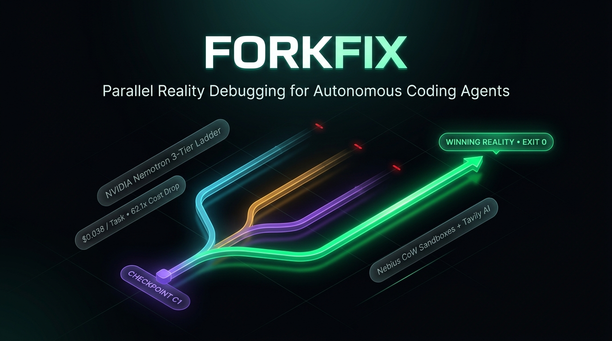

# Forkfix ⚡



> **Parallel Reality Debugging on Open Infrastructure**  
> *Submitted to the Nebius x NVIDIA Global AI Hackathon (Coding and Agentic Engineering Track)*

[](LICENSE)
[](forkfix/backend/tests/)
[](forkfix/frontend/)
[](action.yml)

---

## ⚡ What is Forkfix?

Most autonomous coding agents debug linearly: they make an edit, get stuck, hallucinate, and burn high-tier reasoning tokens on repetitive failures.

**Forkfix** replaces linear trial-and-error with **Parallel Reality Debugging**:

1. **Deterministic Checkpoint (C1):** A thinking model (`nvidia/nemotron-3-super-120b-a12b`) synthesizes a standalone `/tmp/repro.py` and proves non-zero failure in an isolated sandbox.
2. **Parallel Exploration (Fast Tier):** From checkpoint C1, Forkfix forks **4 concurrent reality branches** powered by hyper-efficient `nvidia/Nemotron-3_5-Lightning` ($0.06/$0.24 per 1M tokens), each pursuing diversified hypothesis mandates.
3. **Deterministic Oracle Verification:** Candidate branches run their patches in isolated sandboxes. The smallest clean passing git diff with dual-pass verification is crowned the winner.
4. **Tavily + Nemotron-3-Ultra Escalation:** If all fast attempts fail, error signatures are decomposed into three research lenses via **Tavily Search & Extract** (with strict anti-leakage domain exclusion) and fed into `nvidia/Nemotron-3-Ultra-550b-a55b` with `enable_thinking=True` to synthesize root causes and launch 3 targeted remediation branches.
5. **Interactive Time Travel:** Developers inspect the React Flow execution tree, click any past snapshot, and fork a custom reality branch with human steering hints.

```
                      [GitHub Issue Description]
                                  │
                       [Checkpoint C1 Creation]
                  (Synthesize & verify /tmp/repro.py)
                                  │
          ┌───────────────┬───────┴───────┬───────────────┐
          ▼               ▼               ▼               ▼
      [Branch 1]      [Branch 2]      [Branch 3]      [Branch 4]
      (Lightning)     (Lightning)     (Lightning)     (Lightning)
          │               │               │               │
     [Pass/Fail]     [Pass/Fail]     [Pass/Fail]     [Pass/Fail]
          │               │               │               │
          └───────────────┼───────────────┘               │
                          ▼                               ▼
                 If all Fast fail:                  If any pass:
          [Tavily Research & Extract]             [Winner Selected]
                          │                   (Smallest verified patch)
             [Nemotron-3-Ultra-550B]                      │
          (Deep Thinking Root Cause RCA)                  ▼
                          │                        [Verified PR]
            ┌─────────────┴─────────────┐
            ▼             ▼             ▼
        [Remed 1]     [Remed 2]     [Remed 3]
         (Super)       (Super)       (Super)
```

---

## 🛠️ Technology Stack

| Layer | Technology | Purpose |
|---|---|---|
| **VM Sandboxes** | Nebius Token Factory Sandboxes (`contree-sdk`) / Docker / Mock | Copy-on-write immutable checkpointing and isolated branch verification. |
| **Fast Parallel Exploration** | `nvidia/Nemotron-3_5-Lightning` | Extreme throughput (140 tok/s) and sub-dime pricing ($0.06/M) for broad search. |
| **Repro & Guided Fixes** | `nvidia/nemotron-3-super-120b-a12b` | 120B reasoning powerhouse for reproduction test synthesis and AST repair. |
| **Root-Cause Escalation** | `nvidia/Nemotron-3-Ultra-550b-a55b` | Flagship 550B reasoning model with `enable_thinking=True` for complex diagnostics. |
| **Autonomous Web Grounding** | Tavily Search & Extract API | Multi-query technical documentation retrieval with domain exclusions to prevent benchmark leakage. |
| **Frontend UI** | Next.js 14 App Router, `@xyflow/react`, Tailwind CSS | Obsidian-dark interactive canvas, branch comparator, patch editor, and telemetry scrubber. |
| **Backend API** | FastAPI, SSE Streaming, SQLite, Pydantic v2 | Real-time event streaming, token metering, and rate-limited API endpoints. |
| **CI / CD & Packaging** | Composite GitHub Action (`action.yml`) | Turnkey installation on any GitHub repository to resolve issues automatically. |

---

## 🚀 Quickstart

### Prerequisites
- Python 3.12+
- Node.js 18+
- Nebius Token Factory API Key (`NEBIUS_API_KEY`)
- Tavily API Key (`TAVILY_API_KEY`)

### 1. Backend Setup
```bash
cd forkfix/backend
cp ../.env.example .env
# Edit .env with your credentials

pip install -r requirements.txt
python -m uvicorn forkfix.backend.main:app --reload --port 8000
```

### 2. Frontend Setup
```bash
cd forkfix/frontend
npm install
npm run dev
```

Visit [http://localhost:3000](http://localhost:3000) to access the interactive dashboard.

### 3. Docker Compose (Full Stack)
```bash
docker-compose up --build
```
This launches the FastAPI backend on port 8000 and the Next.js frontend on port 3000.

---

## 🎮 Evaluation Modes for Judges

### 1. Verified Replay Mode (Zero API Keys Required)
Judges can evaluate the full application without setting up cloud credentials:
1. Open [http://localhost:3000](http://localhost:3000).
2. Ensure **Mode: Verified Replay** is active.
3. Select any verified task (`Django #31422` or `Sympy #18059`).
4. Use the playback scrubber controls (`Play`, `Pause`, `1x`, `2x`, `4x`) to inspect the parallel race, terminal output, Tavily grounding, and patch diff.

### 2. Live Sandbox Mode
Switch to **Live Sandbox**, enter an issue description, choose an engine (`mock`, `docker`, or `contree`), and click **Start Live Run**. The client connects to the FastAPI SSE stream and renders checkpoints, parallel branches, and escalation steps in real-time.

---

## 🧪 Testing & Verification

### Run Backend Unit Tests (34 Tests)
```bash
cd forkfix/backend
pytest -v
```

### Run Frontend Production Build & Typecheck
```bash
cd forkfix/frontend
npm run build
```

### Run SWE-bench Benchmark Harness
```bash
python -m forkfix.eval.run_benchmark --engine mock --concurrency 5
```

### Test GitHub Action Runner Headless CLI
```bash
python -m forkfix.action_runner --issue-text "Django currency formatting fails in sanitize_separators" --engine mock
```

---

## 📦 GitHub Action Integration

Add Forkfix to any repository in `.github/workflows/forkfix.yml`:

```yaml
name: Forkfix Parallel Reality Debugger

on:
  issues:
    types: [labeled]

jobs:
  resolve:
    if: github.event.label.name == 'forkfix'
    runs-on: ubuntu-latest
    steps:
      - uses: actions/checkout@v4
      - uses: ./
        with:
          nebius_api_key: ${{ secrets.NEBIUS_API_KEY }}
          tavily_api_key: ${{ secrets.TAVILY_API_KEY }}
          issue_text: ${{ github.event.issue.body }}
          max_branches: 4
```

---

## 📄 License & Telemetry

- **License:** Apache 2.0 (see [LICENSE](LICENSE))
- **Platform Telemetry & Developer Feedback:** See [`forkfix/FEEDBACK.md`](forkfix/FEEDBACK.md) for empirical latency benchmarks, SDK ergonomic observations, and feature recommendations for Nebius, NVIDIA, and Tavily.
