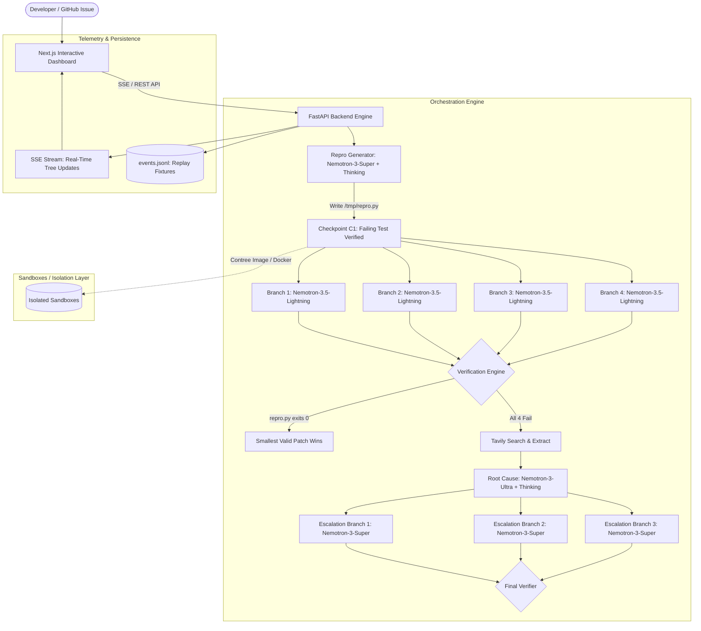

# Forkfix: System Architecture & Technical Specification

## 1. High-Level Architectural Topology



---

## 2. Sandbox Execution Engine (`SandboxEngine` Interface)

To ensure zero downtime whether using Nebius Token Factory Sandboxes or local Docker environments, Forkfix defines a unified asynchronous engine interface:

```python
class SandboxSession(Protocol):
    uuid: str
    
    async def run(
        self,
        shell: str,
        cwd: str = "/testbed",
        files: dict[str, bytes] | None = None,
        disposable: bool = False,
        timeout: int = 120
    ) -> ExecResult:
        ...

class SandboxEngine(Protocol):
    async def use(self, image_uuid: str, strict: bool = True) -> SandboxSession:
        ...
```

### 2.1 Contree Implementation (Production / Token Factory)
- Leverages `contree-sdk`:
  - `ct.images.use(image_uuid, strict=True)` loads or references preloaded SWE environments.
  - Non-disposable runs (`disposable=False`) persist the container state and return a new image UUID representing the checkpoint snapshot.
  - Disposable runs (`disposable=True`) test verification without altering the snapshot state.

### 2.2 Docker Implementation (Local / Testing Fallback)
- Container-based execution using `docker`:
  - Each step runs inside an isolated container.
  - State persistence achieved via `docker commit <container_id> <snapshot_tag>`.
  - Guarantees complete offline functionality and zero-dependency testing during CI/CD.

---

## 3. Tri-Tier Nemotron Cognitive Ladder

The core efficiency breakthrough of Forkfix is avoiding premature escalation to giant models.

| Cognitive Stage | Model Identifier | Pricing (In/Out per 1M tokens) | Thinking Mode | Role in Forkfix |
|---|---|---|---|---|
| **Tier 1: Repro Generation** | `nvidia/nemotron-3-super-120b-a12b` | $0.30 / $0.90 | `enable_thinking=True` | Generates a minimal, standalone `/tmp/repro.py` that fails on the unmodified repo. |
| **Tier 2: Parallel Search** | `nvidia/Nemotron-3_5-Lightning` | $0.06 / $0.24 | `enable_thinking=False` | 4 concurrent branches executing iterative shell commands (grep, read, edit, test). Max 25 steps, $0.15 budget cap per branch. |
| **Tier 3: Root-Cause Synthesis** | `nvidia/Nemotron-3-Ultra-550b-a55b` | $1.00 / $3.00 | `enable_thinking=True` | Ingests 4 failure traces + Tavily web evidence to deduce the non-obvious algorithmic flaw. |
| **Tier 4: Guided Remediation** | `nvidia/nemotron-3-super-120b-a12b` | $0.30 / $0.90 | `enable_thinking=False` | 3 targeted branches executing repairs informed by the Ultra diagnosis. |

---

## 4. Tavily Research & Ground-Truth Pipeline

When 4 fast exploration branches fail, the failure is rarely due to simple syntax; it usually stems from:
- Obscure library internals or undocumented breaking changes.
- Complex runtime errors with cryptic stack traces.

### 4.1 Search Strategy
```python
from tavily import AsyncTavilyClient

async def fetch_ground_truth(error_signature: str, repo_name: str):
    tv = AsyncTavilyClient()
    # Exclude direct repo URLs during benchmarks to avoid benchmark data leakage
    hits = await tv.search(
        query=f"{repo_name} {error_signature}",
        search_depth="advanced",
        chunks_per_source=3,
        max_results=5,
        exclude_domains=["github.com", "gitlab.com"]
    )
    # Extract deep technical pages for the top 2 hits
    extracted = []
    for hit in hits["results"][:2]:
        ext = await tv.extract(urls=[hit["url"]])
        if ext and ext.get("results"):
            extracted.append({"url": hit["url"], "content": ext["results"][0]["raw_content"][:3000]})
    return hits["results"], extracted
```

---

## 5. Event-Driven Real-Time SSE Stream Protocol

All orchestrator actions emit typed JSON events consumed simultaneously by:
1. The **FastAPI SSE Endpoint** (`/api/stream/{run_id}`) for the Next.js live UI.
2. The **JSONL Logger** (`runs/{run_id}/events.jsonl`) for instant benchmark auditing and replay mode.

### Event Types & Payloads
```json
// 1. Checkpoint Created
{
  "event": "checkpoint_created",
  "data": { "checkpoint_id": "C1", "image_uuid": "img-98a72b", "repro_script": "...", "repro_output": "AssertionError: ..." }
}

// 2. Branch Spawned
{
  "event": "branch_spawned",
  "data": { "branch_id": "b1", "parent_checkpoint": "C1", "tier": "fast", "model": "nvidia/Nemotron-3_5-Lightning" }
}

// 3. Agent Execution Step
{
  "event": "step_executed",
  "data": {
    "branch_id": "b1",
    "step_idx": 4,
    "command": "sed -i 's/foo/bar/g' src/parser.py && pytest",
    "stdout": "[exit=0] 1 passed",
    "cumulative_cost": 0.0182,
    "snapshot_uuid": "img-step-4"
  }
}

// 4. Escalation Triggered
{
  "event": "escalation_triggered",
  "data": {
    "reason": "All 4 fast branches exhausted step limit without green test",
    "tavily_queries": ["pytest AssertionError parser tokens"],
    "tavily_citations": [
      { "title": "Pytest AST Documentation", "url": "https://docs.pytest.org/..." }
    ],
    "ultra_diagnosis": "The parser fails because token offsets are 0-indexed in v2.3..."
  }
}

// 5. Winner Selected
{
  "event": "winner_selected",
  "data": {
    "winning_branch_id": "b3",
    "patch": "diff --git a/src/parser.py b/src/parser.py\n...",
    "patch_size_bytes": 142,
    "total_run_cost": 0.043,
    "elapsed_seconds": 38.4
  }
}
```

---

## 6. Time-Travel & Interactive Hint Engine

Unlike black-box coding CLIs, Forkfix empowers human-in-the-loop debugging:
- Every node in the execution graph holds an immutable snapshot ID (`image_uuid`).
- In the UI, the developer clicks any node (even a failed branch step).
- The developer types a hint: *"Look at line 84 in auth.py where token expiry is parsed"*.
- The backend triggers:
  `branch(ct, selected_node_image_uuid, issue, hint=developer_hint)`
- A new interactive child branch appears instantly in the graph tree, continuing from that exact VM state without re-running prior commands!
